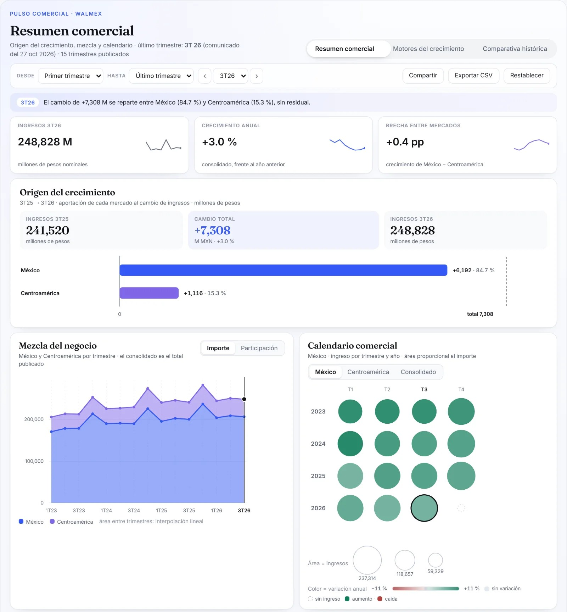

# Pulso comercial · Walmex

Analiza ventas, crecimiento y desempeño comercial de **Walmart de México y
Centroamérica** a partir de sus comunicados trimestrales oficiales, con el puente
de origen del crecimiento y la comparación contra el mismo trimestre del año
anterior.

[](https://github.com/Dev-HugoAguilar/walmex-financial-pulse/actions/workflows/tests.yml)
[](app)
[](#datos-y-atribución)

> **Alcance.** Solo información **pública** de los comunicados trimestrales. Este
> proyecto no está vinculado ni patrocinado por Walmex.

---

## Ejecutar

Aplicación React + Vite sin backend propio: consume la API compartida
[`portfolio-api`](https://github.com/Dev-HugoAguilar/portfolio-api) (FastAPI + MongoDB)
en el puerto **8010**. La API no se copia en este repositorio — se clona aparte —
para no duplicar código ni datos.

### 1. Requisitos

- **Python 3.12** para la API.
- **Node.js 20 o superior** con `npm` (verificado con Node 24.11.0 y npm 11.6.1).
- **MongoDB**, Atlas o local: solo hace falta la URI de conexión.

### 2. API en el puerto 8010

```bash
git clone https://github.com/Dev-HugoAguilar/portfolio-api.git
cd portfolio-api
python -m venv .venv
```

Activa el entorno virtual:

```bash
# Windows (PowerShell o CMD)
.venv\Scripts\activate
# Linux / macOS
source .venv/bin/activate
```

Instala y arranca:

```bash
pip install -r requirements-dev.txt
cp .env.example .env        # Windows PowerShell: Copy-Item .env.example .env
python -m uvicorn app.main:app --port 8010
```

Variables que hay que rellenar en `.env` (no se versiona):

| Variable | Qué poner |
|---|---|
| `MONGODB_URI` | **Obligatoria.** URI de conexión de MongoDB: cadena de Atlas (`mongodb+srv://…`, con el usuario y la clave del clúster) o local (`mongodb://127.0.0.1:27017/hugo_portfolio`). |
| `MONGODB_DB` | Base donde están las colecciones publicadas (`hugo_portfolio`). |
| `ALLOWED_ORIGINS` | Orígenes permitidos por CORS; ver el paso 3. |
| `MONGO_ROOT_*`, `APP_DB_*`, `BACKEND_HOST_PORT` | Solo si levantas MongoDB/API con Docker Compose. |
| `MARKETING_GCP_PROJECT` | Solo para volver a extraer datos de GA4 desde BigQuery; la API y el tablero leen de MongoDB. |

`/health/ready` comprueba proceso **y** MongoDB:

```bash
curl http://127.0.0.1:8010/api/v1/health/ready
# {"status":"ready","mongo":"ok","version":"1.0.0"}
```

### 3. Aplicación en el puerto 5173

```bash
cd app
npm ci
npm run dev
```

Vite sirve en <http://127.0.0.1:5173>. El cliente consulta la API en
`http://127.0.0.1:8010/api/v1/walmex` (ver `app/src/api/cliente.ts`), así que la
petición es **de otro origen** (5173 → 8010).

**CORS.** Si la API no autoriza el origen del dev server, el navegador bloquea la
respuesta: error de CORS en la consola y el tablero se queda sin datos. Añade los
dos orígenes de desarrollo a `ALLOWED_ORIGINS` en el `.env` de la API y reinicia
uvicorn:

```env
ALLOWED_ORIGINS=http://localhost:8000,http://127.0.0.1:8000,http://127.0.0.1:5173,http://localhost:5173
```

La lista va separada por comas, sin espacios.

### 4. Compilación de producción

```bash
npm run build
```

Ejecuta `tsc --noEmit` y `vite build`. La salida queda en **`app/dist/`** (`app.js`
y `app.css`), el módulo que el portafolio carga con `import()`.

### 5. Comprobación funcional

Endpoint real de este tablero (definido en `app/api/v1/routes/walmex.py` de la API):

```bash
curl http://127.0.0.1:8010/api/v1/walmex/estado
```

Debe responder `HTTP 200` con `datos_disponibles`, `version`, `fuente`, `periodo`,
`cobertura`, `notas` y `avisos`. Obtenido al verificar este repositorio:
`"datos_disponibles": true`, `"version": "walmex-3t26"` y periodo de `1T23` a
`3T26` (15 trimestres). Si `datos_disponibles` es `false`, la base no tiene versión
publicada: se prepara y publica con `python -m scripts.preparar_walmex` y
`python -m scripts.publicar_walmex --aplicar` en el repo de la API (la API no
inventa cifras).

Con la API en marcha, abre <http://127.0.0.1:5173>: el puente de crecimiento, las
áreas apiladas y el calendario deben mostrar la misma versión que devolvió
`/estado`.

> **Versión compatible:** probado con `portfolio-api` en el commit `8a27227`.



## Qué demuestra

- **Validación antes de publicar**: México + Centroamérica debe sumar el
  consolidado; ventas netas + otros ingresos debe sumar el total; y la variación
  calculada con importes debe coincidir con la publicada.
- **Lectura interanual**: cada trimestre se compara con el mismo trimestre del año
  anterior, no con el inmediato anterior.
- **Nueve visualizaciones** en tres vistas: puente de origen del crecimiento,
  áreas apiladas y calendario de círculos proporcionales.
- **Huecos declarados**: los trimestres sin dato se muestran como «no publicado»,
  nunca como cero.

## Datos y atribución

**Walmart de México y Centroamérica (Walmex)**: comunicados trimestrales de
resultados y «Estados Financieros» publicados en walmex.mx. Cubre del **1T23 al
3T26: 15 trimestres y 16 documentos oficiales** (un comunicado y un libro de
estados financieros por trimestre, más el histórico de ventas). La fecha de
publicación se toma del propio comunicado.

## Estructura

```text
app/                 Aplicación React + TypeScript (Vite)
  src/               Puente de crecimiento, áreas apiladas y calendario
  tools/             Minificador y utilidades de build
docs/LEEME.md        Documentación original del proyecto
docs/cover.jpg       Captura real de la aplicación
```

## Límites

- Sin detalle por tienda, formato, producto ni cliente, y sin metas de la empresa.
- El comercio electrónico (ventas netas y GMV) queda fuera: su definición cambia
  entre trimestres y no cubre todo el periodo.
- Tráfico y ticket solo se publican desde 2024: la vista de motores cubre **10 de
  los 15** trimestres y los huecos se marcan como «no publicado».
- Los importes son **millones de pesos nominales** del periodo, sin ajuste por
  inflación ni por tipo de cambio.

## Seguridad y contribución

Sin credenciales ni datos personales en el repositorio. Ver [`SECURITY.md`](SECURITY.md)
y [`CONTRIBUTING.md`](CONTRIBUTING.md).
